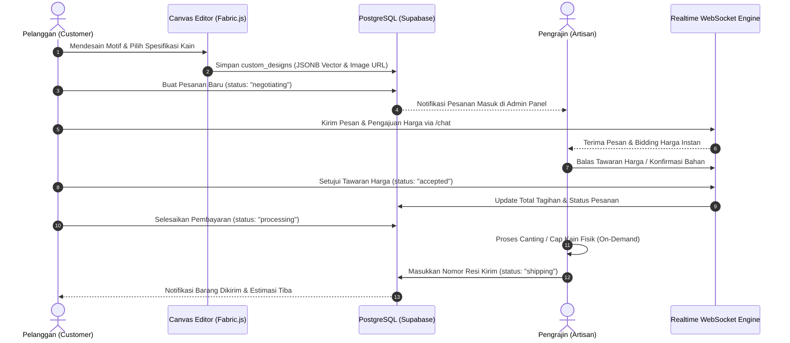

# 📑 DOKUMENTASI MASTER REKABATIK: STRATEGI BISNIS, ANALISIS PASAR, PRD, DAN INTEGRASI SDGS

---

## 📌 DAFTAR ISI
1. [Ringkasan Eksekutif & Identitas Proyek](#1-ringkasan-eksekutif--identitas-proyek)
2. [Pemetaan & Kesinambungan Mendalam dengan SDGs PBB](#2-pemetaan--kesinambungan-mendalam-dengan-sdgs-pbb)
   - 2.1. Pilar Utama (Core Anchor SDGs)
   - 2.2. Pilar Pendukung Fungsional (Secondary SDGs)
   - 2.3. Matriks Hubungan Indikator PBB & Bukti Kode Implementasi
   - 2.4. Faktor Keberlanjutan Paling Menonjol (*The Prime Sustainability Factor*)
3. [Analisis Pasar Komprehensif (Market Analysis)](#3-analisis-pasar-komprehensif-market-analysis)
   - 3.1. Ukuran Pasar (TAM, SAM, SOM)
   - 3.2. Segmentasi Target Pasar & Karakteristik Konsumen
   - 3.3. Analisis Kompetitif (Competitive Landscape Matrix)
   - 3.4. Analisis SWOT (Strengths, Weaknesses, Opportunities, Threats)
   - 3.5. Analisis PESTLE
4. [Strategi Bisnis & Model Finansial](#4-strategi-bisnis--model-finansial)
   - 4.1. Business Model Canvas (BMC) 9 Blok
   - 4.2. Arsitektur Monetisasi & Aliran Pendapatan (*Revenue Streams*)
   - 4.3. Unit Economics & Rantai Nilai (*Value Chain*)
   - 4.4. Strategi Go-To-Market (GTM)
5. [Product Requirement Document (PRD)](#5-product-requirement-document-prd)
   - 5.1. Pernyataan Masalah & Sasaran (*Goals & Objectives*)
   - 5.2. User Persona
   - 5.3. Spesifikasi Kebutuhan Fungsional (Functional Requirements)
   - 5.4. Kebutuhan Non-Fungsional (Non-Functional Requirements)
   - 5.5. Arsitektur Alur Sistem & Diagram Data
6. [Manajemen Risiko, Metrik Keberhasilan (KPI), & Roadmap](#6-manajemen-risiko-metrik-keberhasilan-kpi--roadmap)
   - 6.1. Matriks Risiko & Mitigasi
   - 6.2. Metrik Keberhasilan Terukur (Business, Cultural & Green KPIs)
   - 6.3. Roadmap Pengembangan Jangka Panjang

---

# 1. RINGKASAN EKSEKUTIF & IDENTITAS PROYEK

### 1.1. Profil Proyek
* **Nama Platform:** RekaBatik
* **Klasifikasi:** *Web-Based Interactive Batik Customization & Fair-Trade Artisan Marketplace*
* **Subtema:** *Smart Sustainable Digital Solution for Inclusive Society*
* **Target Utama Pengguna:** Konsumen Muda (Gen Z/Milenial), Korporasi/Komunitas, serta Pengrajin UMKM Sentra Batik Tradisional (Studi Kasus: Kampung Batik Jetis, Sidoarjo).

### 1.2. Problem Statement (Akar Masalah)
1. **Krisis Regenerasi Budaya Wastra:** Generasi muda memandang batik konvensional sebagai busana formal yang kaku dan seragam. Minimnya ruang personalisasi visual menyebabkan rendahnya keterikatan emosional anak muda terhadap motif wastra leluhur.
2. **Ketergantungan Tengkulak & Asimetri Pasar:** Pengrajin batik tradisional di sentra daerah bergantung pada tengkulak dengan margin tipis dan tanpa kepastian pasar. Pengrajin tidak memiliki platform digital mandiri untuk menjangkau pasar nasional secara setara.
3. **Pencemaran Limbah Tekstil (*Deadstock Crisis*):** Model industri fashion konvensional beroperasi dengan metode produksi spekulatif massal. Sebanyak 30-40% produk pakaian berakhir menjadi stok mati (*deadstock*) yang terbuang dan mencemari lingkungan dengan limbah kimia pewarna tekstil.

### 1.3. Solusi Terintegrasi RekaBatik
RekaBatik menghadirkan platform hibrida yang memadukan **Studio Kustomisasi Berbasis Vektor Web (Fabric.js)**, **Sistem Negosiasi Harga Adil (*Fair-Trade Bidding*)**, dan **Etalase Digital Sentra Pengrajin**. Dengan mengusung paradigma *Made-to-Order*, RekaBatik menyelesaikan masalah limbah tekstil sekaligus mengangkat kesejahteraan ekonomi pengrajin kriya daerah.

---

# 2. PEMETAAN & KESINAMBUNGAN MENDALAM DENGAN SDGS PBB

RekaBatik tidak sekadar mengutip tujuan global PBB sebagai hiasan presentasi, melainkan menanamkan indikator-indikator tersebut secara fungsional ke dalam modul dan arsitektur kode aplikasi.

```
                  ┌──────────────────────────────────────────────┐
                  │          EKOSISTEM SDGS REKABATIK            │
                  └──────────────────────┬───────────────────────┘
                                         │
         ┌───────────────────────────────┼──────────────────────────────┐
         ▼                               ▼                              ▼
 💼 SDG 8: DECENT WORK           🏛️ SDG 11: SUSTAINABLE         ♻️ SDG 12: RESPONSIBLE
  & ECONOMIC GROWTH               CITIES & COMMUNITIES           PRODUCTION & CONSUMPTION
  • Fair-Trade Negotiation       • Digital Cultural Heritage    • Made-to-Order Zero Waste
  • Artisan Independent Portal   • Kampung Jetis Revitalization • Natural Dye & Fabric Option
  • Anti-Tengkulak Ecosystem     • Interactive Philosophy Edu   • Precision Fabric Cutting
```

---

### 2.1. Pilar Utama (Core Anchor SDGs)

#### 💼 1. SDG 8: Decent Work and Economic Growth (Target 8.3 & 8.9)
* **Deskripsi Target PBB:**
  * **8.3:** Mempromosikan kebijakan berorientasi pembangunan yang mendukung produktivitas, penciptaan lapangan kerja layak, kewirausahaan, serta formalisasi dan pertumbuhan UMKM.
  * **8.9:** Merumuskan dan melaksanakan kebijakan pariwisata berkelanjutan yang menciptakan lapangan kerja dan mempromosikan budaya dan produk lokal.
* **Manifestasi Fungsional di RekaBatik:**
  * **Portal Manajemen Artisan Mandiri:** Pengrajin kriya di sentra tradisional memiliki dasbor mandiri untuk mengelola pesanan, katalog karya, status produksi, hingga pelacakan logistik tanpa perantara perantara eksploitatif.
  * **Sistem Negosiasi Harga Real-Time (Fair-Trade Bidding):** Mengakui bahwa pembuatan batik tulis manual membutuhkan keterampilan teknis dan waktu yang intensif. Platform memfasilitasi pengrajin untuk menetapkan dan menyepakati harga yang pantas (*fair compensation*), bukan harga pabrikan yang menindas.

#### 🏛️ 2. SDG 11: Sustainable Cities and Communities (Target 11.4)
* **Deskripsi Target PBB:**
  * **11.4:** *Strengthen efforts to protect and safeguard the world’s cultural and natural heritage* (Memperkuat upaya melindungi dan melestarikan warisan budaya dan alam dunia).
* **Manifestasi Fungsional di RekaBatik:**
  * **Revitalisasi Sentra Budaya Kampung Batik:** Halaman khusus mengabadikan dan mempromosikan Kampung Batik Jetis Sidoarjo (sentra budaya sejak tahun 1675) sebagai komunitas perkotaan/pedesaan yang mandiri dan lestari secara ekonomi.
  * **Digitalisasi Pakem & Filosofi Luhur:** Mengintegrasikan ensiklopedia motif batik klasik (Parang, Kawung, Mega Mendung, Truntum, Sidomukti, Sekar Jagad) dengan makna filosofis mendalam agar tidak terdistorsi menjadi komoditas estetika dangkal.

#### ♻️ 3. SDG 12: Responsible Consumption and Production (Target 12.2 & 12.5)
* **Deskripsi Target PBB:**
  * **12.2:** Pengelolaan berkelanjutan dan pemanfaatan sumber daya alam secara efisien.
  * **12.5:** Mengurangi timbulan limbah secara substansial melalui pencegahan (*prevention*), pengurangan (*reduction*), daur ulang, dan penggunaan kembali.
* **Manifestasi Fungsional di RekaBatik:**
  * **Paradigma Produksi Made-to-Order (Nol Stok Mati / Zero Deadstock):** Kain dan lilin malam hanya digunakan jika pesanan sudah disetujui dan dibayar oleh pemesan. Tidak ada kain yang menumpuk di gudang dan menjadi sampah fesyen.
  * **Efisiensi Material Tekstil:** Pembeli dan pengrajin menentukan dimensi kain, jenis serat (Mori Primissima, Katun Dobby, Sutra ATBM), dan opsi pewarnaan alami yang meminimalkan buangan air limbah sintetis.

---

### 2.2. Pilar Pendukung Fungsional (Secondary SDGs)

* **💡 SDG 9: Industry, Innovation, and Infrastructure (Target 9.b & 9.c):**
  Inovasi teknologi grafis kanvas browser berbasis *Fabric.js Retained-Mode* dan *Offscreen Bitmap Canvas*. Menghadirkan alat rancang grafis setara software profesional yang dapat diakses melalui peramban gratis oleh masyarakat dan pengrajin daerah.
* **📚 SDG 4: Quality Education (Target 4.7):**
  Pendidikan kebudayaan terbuka bagi publik. Modul *Belajar Batik* menyediakan sarana edukasi kultural interaktif bagi generasi muda untuk memahami akar filosofis wastra nusantara.
* **⚖️ SDG 10: Reduced Inequalities (Target 10.2):**
  Mengikis kesenjangan ekonomi dan digital antara komunitas pengrajin lokal pedesaan dengan pasar konsumen urban metropolitan.

---

### 2.3. Matriks Hubungan Indikator PBB & Bukti Kode Implementasi

| Indikator Target SDG | Fitur Aplikasi Terkait | Lokasi File Sumber (*Code Path*) | Komponen Teknis & Cara Kerja |
|---|---|---|---|
| **SDG 8.3 & 8.9** (Pemberdayaan UMKM & Lapangan Kerja Lokal) | Modul Dasbor Mitra Pengrajin & Toko Mandiri | [`AdminPage.tsx`](file:///c:/Users/nadem/Downloads/Batik%20Customization%20Website/src/app/pages/AdminPage.tsx) & [`ArtisanStorePage.tsx`](file:///c:/Users/nadem/Downloads/Batik%20Customization%20Website/src/app/pages/ArtisanStorePage.tsx) | Manajemen inventori pesanan kustom, status pengerjaan, galeri portofolio, input resi kirim, dan kalkulator margin pengrajin. |
| **SDG 8.5** (Penghasilan Adil / *Fair Compensation*) | Penawaran & Negosiasi Harga Fleksibel | [`ChatPage.tsx`](file:///c:/Users/nadem/Downloads/Batik%20Customization%20Website/src/app/pages/ChatPage.tsx) | Alur obrolan WebSocket Supabase Realtime dengan komponen `price_offer`, aksi `accepted`/`rejected`, serta konfirmasi persetujuan harga adil. |
| **SDG 11.4** (Pelestarian Warisan Budaya UNESCO) | Showcase Sentra Desa Jetis & Ensiklopedia Budaya | [`DesaJetisPage.tsx`](file:///c:/Users/nadem/Downloads/Batik%20Customization%20Website/src/app/pages/DesaJetisPage.tsx) & [`BelajarBatikPage.tsx`](file:///c:/Users/nadem/Downloads/Batik%20Customization%20Website/src/app/pages/BelajarBatikPage.tsx) | Linimasa sejarah 1675, direktori bengkel perajin, rute wisata kriya, kurasi makna filosofis 6 motif sakral, dan visualizer pola SVG. |
| **SDG 12.5** (Pengurangan Timbulan Limbah Tekstil) | Studio Kustomisasi Vektor *On-Demand* | [`CustomBatikPage.tsx`](file:///c:/Users/nadem/Downloads/Batik%20Customization%20Website/src/app/pages/CustomBatikPage.tsx) & [`CheckoutPage.tsx`](file:///c:/Users/nadem/Downloads/Batik%20Customization%20Website/src/app/pages/CheckoutPage.tsx) | Produksi berbasis rancangan terverifikasi, kalkulasi kebutuhan bahan spesifik, mencegah *deadstock* pakaian jadi massal. |
| **SDG 9.b** (Inovasi Teknologi Lokal Terbuka) | Dual-Canvas Hybrid Engine (Vector + Raster) | [`CustomBatikPage.tsx`](file:///c:/Users/nadem/Downloads/Batik%20Customization%20Website/src/app/pages/CustomBatikPage.tsx) | Arsitektur rendering Fabric.js 60 FPS dipadu dengan Offscreen Canvas HTML5 untuk coretan kuas bebas tanpa lag memori. |

---

### 2.4. Faktor Keberlanjutan Paling Menonjol (*The Prime Sustainability Factor*)

> **FAKTOR UTAMA:** **"Pergeseran Paradigma Produksi dari Fast-Fashion Spekulatif Menjadi Manufaktur Presisi On-Demand (Zero Deadstock & Fair Trade)."**

Dalam industri fesyen konvensional, 35% kain yang diproduksi tidak pernah dipakai oleh siapa pun dan terbuang ke TPA. RekaBatik menyelesaikan masalah ini dari akarnya: **kain mori baru dipotong dan canting baru digoreskan ketika desain visual, spesifikasi bahan, dan kesepakatan harga antara pemesan dan pembatik telah tuntas disepakati**. Dengan demikian, efisiensi bahan mentah mencapai titik maksimal dan tidak menyisakan limbah stok mati.

---

# 3. ANALISIS PASAR KOMPREHENSIF (MARKET ANALYSIS)

### 3.1. Ukuran Pasar (TAM, SAM, SOM)

```
┌────────────────────────────────────────────────────────────────────────┐
│                   TOTAL ADDRESSABLE MARKET (TAM)                       │
│    Pasar Industri Batik & Tekstil Nasional Indonesia: Rp 8,4 Triliun   │
│  ┌──────────────────────────────────────────────────────────────────┐  │
│  │                SERVICEABLE AVAILABLE MARKET (SAM)                │  │
│  │    Segmen Batik Moderen & Kustomisasi Konsumen Urban: Rp 1,2 T   │  │
│  │  ┌────────────────────────────────────────────────────────────┐  │  │
│  │  │            SERVICEABLE OBTAINABLE MARKET (SOM)             │  │  │
│  │  │      Penetrasi Digital Sentra Kriya Jawa Timur: Rp 45 M    │  │  │
│  │  └────────────────────────────────────────────────────────────┘  │  │
│  └──────────────────────────────────────────────────────────────────┘  │
└────────────────────────────────────────────────────────────────────────┘
```

1. **Total Addressable Market (TAM):**
   * Nilai transaksi industri batik dan busana wastra nusantara diperkirakan mencapai lebih dari **Rp 8,4 Triliun per tahun** (Kemenperin RI), mencakup produksi batik tulis, cap, dan printing di seluruh Indonesia.
2. **Serviceable Available Market (SAM):**
   * Pasar batik kustom, seragam instansi/komunitas, serta konsumen kelas menengah perkotaan (*urban middle class*) yang memiliki literasi digital dan daya beli produk personalisasi: estimasi **Rp 1,2 Triliun**.
3. **Serviceable Obtainable Market (SOM):**
   * Target realistis 3 tahun awal yang berfokus pada digitalisasi sentra batik Jawa Timur (Sidoarjo, Madura, Mojokerto) dengan estimasi GMV (Gross Merchandise Value) teraih sebesar **Rp 45 Miliar** (3,75% dari SAM).

---

### 3.2. Segmentasi Target Pasar & Karakteristik Konsumen

| Segmen Pengguna | Profil & Karakteristik | *Pain Points* (Masalah Utama) | *Value Proposition* RekaBatik |
|---|---|---|---|
| **Gen Z & Milenial Urban (B2C)** | Usia 18-35 tahun, ekspresif, melek digital, menghargai orisinalitas dan fesyen ramah lingkungan (*conscious consumer*). | Batik konvensional dinilai kuno, motif kaku seragam, sulit menemukan batik yang sesuai selera warna modern. | Kanvas desain interaktif, recoloring multi-layer bebas, edukasi makna filosofis, bangga memakai karya rancangan sendiri. |
| **Korporasi, Institusi, & Komunitas (B2B)** | Perusahaan, institusi pendidikan, kepanitiaan event yang membutuhkan seragam batik berkarakter khas. | Sulit mencari pengrajin yang bisa membuat motif khusus identitas instansi dalam jumlah terukur tanpa biaya cetak cetakan pabrik yang mahal. | Fasilitas pemesanan terpadu langsung ke sentra pengrajin, fleksibilitas motif logo/identitas, transparansi penawaran harga. |
| **Pengrajin Batik Tradisional (Mitra)** | Pelaku UMKM sentra kriya (Jetis Sidoarjo, dsb.), usia 30-65 tahun, keahlian canting/cap tinggi, literasi teknologi dasar. | Ketergantungan pada tengkulak, pasar lokal jenuh, tidak punya kemampuan membuat website e-commerce sendiri. | Dasbor toko siap pakai gratis, sistem negosiasi harga adil, pembayaran transparan, akses pasar konsumen nasional. |

---

### 3.3. Analisis Kompetitif (Competitive Landscape Matrix)

| Dimensi Perbandingan | E-Commerce Standar (Tokopedia/Shopee) | Platform Print-on-Demand (Tees/Custom.co.id) | Butik Batik Konvensional | **RekaBatik** |
|---|:---:|:---:|:---:|:---:|
| **Kustomisasi Motif Vektor Interaktif** | ❌ Tidak Ada | ⚠️ Hanya sablon gambar bitmap | ❌ Tidak Ada | ✅ **Vektor SVG Multi-Layer & Freehand** |
| **Koneksi Langsung ke Sentra Kriya** | ⚠️ Tidak Transparan | ❌ Pabrik Industri Cetak | ⚠️ Rantai Broker | ✅ **Langsung ke Mitra Pengrajin Desa** |
| **Sistem Negosiasi Harga Dinamis** | ❌ Harga Tetap Kaku | ❌ Harga Tetap Kaku | ⚠️ Tawar menawar manual offline | ✅ **Bidding Terintegrasi Real-Time WebSocket** |
| **Edukasi Filosofi & Pelestarian Pakem** | ❌ Tidak Ada | ❌ Tidak Ada | ⚠️ Tergantung Penjual | ✅ **Ensiklopedia Terstruktur & Edukatif** |
| **Prinsip Keberlanjutan Lingkungan** | ❌ Model Konsumsi Massal | ❌ Bahan Poliester/Sintetis | ⚠️ Campuran | ✅ **Made-to-Order Zero Deadstock** |

---

### 3.4. Analisis SWOT

```
┌──────────────────────────────────────────────┬──────────────────────────────────────────────┐
│                  STRENGTHS                   │                  WEAKNESSES                  │
├──────────────────────────────────────────────┼──────────────────────────────────────────────┤
│ • Editor grafis Fabric.js ramah pengguna di web│ • Waktu produksi batik tulis manual memakan  │
│ • Dukungan Supabase Realtime untuk bidding   │   waktu (7-21 hari pengerjaan kriya).        │
│ • Hubungan erat langsung dengan sentra Jetis │ • Edukasi digital awal kepada perajin senior │
│ • Validasi kurasi Super Admin anti-palsu     │   membutuhkan pendampingan lapangan.         │
├──────────────────────────────────────────────┼──────────────────────────────────────────────┤
│                OPPORTUNITIES                 │                   THREATS                    │
├──────────────────────────────────────────────┼──────────────────────────────────────────────┤
│ • Tren peningkatan belanja fesyen berkelanjutan│ • Serbuan kain printing tiruan motif batik   │
│ • Kebijakan wajib seragam wastra nasional    │   murah impor dari luar negeri.              │
│ • Dukungan hibah pemerintah untuk digital UMKM│ • Fluktuasi harga bahan mentah kain & malam. │
└──────────────────────────────────────────────┴──────────────────────────────────────────────┘
```

---

### 3.5. Analisis PESTLE

* **Political (Politik):** Regulasi perlindungan Hak Kekayaan Intelektual (HAKI) dan Keputusan Presiden mengenai Hari Batik Nasional memberikan legitimasi politik kuat bagi pelestarian wastra nusantara.
* **Economic (Ekonomi):** Kenaikan daya beli kelas menengah Indonesia yang beralih dari barang komoditas murah menuju produk kriya bernilai estetika dan bercerita (*storytelling-driven luxury*).
* **Social (Sosial):** Meningkatnya kebanggaan generasi muda mengenakan kain tradisional (*berkain bersama*) dalam kegiatan sehari-hari dan acara formal.
* **Technological (Teknologi):** Kematangan teknologi HTML5 Canvas dan WebSockets di peramban seluler memungkinkan pengalaman desain kompleks tanpa unduhan aplikasi terpisah.
* **Legal (Hukum):** Perlindungan hak cipta motif kedaerahan (Indikasi Geografis & Hak Cipta Komunal) terjaga melalui sistem kurasi Super Admin.
* **Environmental (Lingkungan):** Tuntutan global terhadap sertifikasi rantai pasok fesyen hijau (*eco-friendly fashion*) mendorong adopsi manufaktur bebas limbah sisa (*zero overproduction*).

---

# 4. STRATEGI BISNIS & MODEL FINANSIAL

### 4.1. Business Model Canvas (BMC) 9 Blok

```
┌──────────────────┬─────────────────┬──────────────────┬─────────────────┬──────────────────┐
│   KEY PARTNERS   │  KEY ACTIVITIES │  VALUE PROPOS.   │  CUSTOMER REL.  │CUSTOMER SEGMENTS │
│                  │                 │                  │                 │                  │
│ • Paguyuban      │ • Pengembangan  │ • Studio kustom  │ • Real-time     │ • Gen Z & Kaum   │
│   Pengrajin      │   mesin canvas  │   vektor batik   │   chat personal │   Muda Urban     │
│   Kampung Jetis  │ • Kurasi toko   │ • Hubungan tanpa │ • Transparansi  │ • Korporasi,     │
│ • Dinas Koperasi │   pengrajin     │   tengkulak      │   alur pesanan  │   Sekolah, EO    │
│   & UMKM Daerah  │ • Edukasi       │ • Zero deadstock │ • Edukasi nilai │ • Kolektor Wastra│
│ • Penyedia Jasa  │   filosofi motif│   on-demand      │   budaya        │ • Mitra Pengrajin│
│   Logistik Kirim │ • Fasilitasi    │ • Harga adil     │                 │   Lokal          │
├──────────────────┤   transaksi     │   (fair trade)   ├─────────────────┤                  │
│  KEY RESOURCES   │                 │                  │    CHANNELS     │                  │
│                  │                 │                  │                 │                  │
│ • Arsitektur Web │                 │                  │ • Web Platform  │                  │
│   SPA & Database │                 │                  │ • Media Sosial  │                  │
│ • Aset Vektor SVG│                 │                  │ • Komunitas Kriya│                 │
│ • Komunitas Mitra│                 │                  │ • Pameran Kriya │                  │
├──────────────────┴─────────────────┴──────────────────┴─────────────────┴──────────────────┤
│             COST STRUCTURE                            REVENUE STREAMS                      │
│                                                                                            │
│ • Pemeliharaan Server Cloud & Database (Supabase)     • Biaya Transaksi Berhasil (Platform Fee 7-10%)│
│ • Operasional Tim Kurasi Lapangan & Edukasi Perajin   • Paket B2B Corporate Dedicated Design       │
│ • Pemasaran Digital & Konten Budaya Edukatif          • Opsi Layanan Premium Bahan & Pewarna Alami │
│ • Biaya Gateway Pembayaran & Logistik Integrasi       • Verifikasi Lencana Mitra Resmi Prioritas   │
└────────────────────────────────────────────────────────────────────────────────────────────┘
```

---

### 4.2. Arsitektur Monetisasi & Aliran Pendapatan (*Revenue Streams*)

1. **Marketplace Transaction Fee (Take-Rate 7% – 10%):**
   * Platform memotong biaya layanan wajar dari setiap pesanan kustom yang berhasil diselesaikan dan dibayarkan. Jauh lebih hemat dibanding potongan tengkulak konvensional yang mencapai 40-60%.
2. **Corporate & Community Bulk Customization (B2B Package):**
   * Paket pemesanan seragam batik instansi berfitur asistensi desainer, *mockup preview* korporat, dan pengujian sampel kain fisik dengan nilai kontrak proyek mulai dari Rp 10 Juta hingga Rp 100 Juta per pemesanan.
3. **Premium Natural Dye & Eco-Fabric Add-on:**
   * Fitur *upselling* untuk opsi pewarna alam ramah lingkungan (daun tom indigo, tingi, jolawe) dan kain sutra tenun tangan bersertifikasi ramah lingkungan dengan *revenue sharing* bersama pembatik.
4. **Artisan Verified Badge & Sponsored Placement:**
   * Fitur opsional bagi toko pengrajin mapan untuk mempromosikan bengkel kriyanya di halaman utama beranda dan direktori teratas sentra desa wisata.

---

### 4.3. Unit Economics & Rantai Nilai (*Value Chain*)

* **Simulasi 1 Helai Kain Batik Kustom (Batik Tulis Premium):**
  * Rata-rata Nilai Transaksi (*Average Order Value / AOV*): **Rp 450.000**
  * Hak Bersih Pengrajin Mitra (88%): **Rp 396.000** (Menjamin upah layak dan biaya kain mori prima)
  * Platform Fee RekaBatik (10%): **Rp 45.000**
  * Biaya Payment Gateway & Infrastruktur Cloud (2%): **Rp 9.000**
  * **Laba Kotor per Transaksi:** **Rp 36.000**
* **Skalabilitas:** Dengan proyeksi 500 transaksi per bulan pada tahun ke-2, platform menghasilkan pendapatan berulang (*recurring GMV*) sebesar Rp 225 Juta/bulan dengan *gross profit* platform Rp 18-22 Juta/bulan dari segmen B2C saja, belum termasuk proyek borongan B2B instansi.

---

### 4.4. Strategi Go-To-Market (GTM)

1. **Fase 1: *Anchor Community Infiltration* (Bulan 1-6)**
   * Onboarding intensif 15-20 bengkel pengrajin terkurasi di Kampung Batik Jetis Sidoarjo.
   * Mengadakan lokakarya digitalisasi dan sertifikasi akun mitra toko bersama paguyuban kriya setempat.
2. **Fase 2: *Campus & Cultural Creator Ambassadorship* (Bulan 7-12)**
   * Menggandeng komunitas anak muda pecinta wastra (*Remaja Berkain*, UKM Seni Kampus).
   * Lomba kustomisasi desain kanvas digital di platform berhadiah realisasi desain menjadi kain fisik gratis untuk pemenang.
3. **Fase 3: *B2B Institutional Outbound* (Bulan 13-24)**
   * Menawarkan solusi seragam ramah lingkungan (*sustainable corporate merchandise*) kepada perusahaan startup, BUMN, dan institusi pendidikan dengan narasi pelaporan ESG (*Environmental, Social, Governance*).

---

# 5. PRODUCT REQUIREMENT DOCUMENT (PRD)

---

### 5.1. Pernyataan Masalah & Sasaran (*Goals & Objectives*)
* **Goal Utama:** Membangun platform web terpadu yang memfasilitasi pengguna mendesain kain batik secara digital berbasis vektor dan menghubungkannya secara langsung ke pengrajin sentra lokal untuk diproduksi nyata.
* **Target Keberhasilan (OKRs):**
  * **Objective 1:** Pengalaman desain kustom lancar tanpa hambatan di browser seluler maupun desktop.
    * *KR 1:* Frame rate kanvas stabil di 60 FPS saat memanipulasi layer objek.
    * *KR 2:* Waktu konversi ekspor desain ke format resolusi tinggi kurang dari 2 detik.
  * **Objective 2:** Memfasilitasi negosiasi harga transparan berbasis kesepakatan adil.
    * *KR 1:* Keterlambatan pesan obrolan WebSocket di bawah 300 ms (*real-time latency*).
    * *KR 2:* 100% pesanan yang masuk ke pengrajin memiliki status kepastian harga sebelum pembayaran dibuka.

---

### 5.2. User Persona

#### 👤 Persona 1: End-Consumer (Generasi Muda Kreatif)
* **Nama:** Dimas Pratama (23 tahun)
* **Profesi:** Desainer Grafis / Pegawai Kreatif di Jakarta
* **Motivasi:** Ingin memakai baju batik dengan motif tradisional tetapi memiliki palet warna modern (pastel/earth-tone) yang tidak pasaran untuk acara wisuda dan kantor.
* **Frustrasi:** Toko batik online hanya menjual motif kemeja bapak-bapak yang membosankan dan tidak bisa meminta variasi warna khusus.

#### 👤 Persona 2: Artisan Mitra (Pengrajin Sentra Kriya)
* **Nama:** Ibu Sunarsih (52 tahun)
* **Profesi:** Pemilik Sanggar Batik Canting Tulis di Jetis Sidoarjo
* **Motivasi:** Ingin karya sanggarnya dikenal pembeli luar kota tanpa harus menjual murah ke pedagang pengepul di pasar grosir.
* **Frustrasi:** Tidak paham coding atau cara mengelola server web; sering merugi jika pembeli meminta motif rumit tetapi menawar harga semena-mena.

---

### 5.3. Spesifikasi Kebutuhan Fungsional (Functional Requirements)

```
┌────────────────────────────────────────────────────────────────────────┐
│                     REKABATIK FUNCTIONAL SCOPE                         │
├─────────────────────┬────────────────────┬─────────────────────────────┤
│ 1. DESIGN STUDIO    │ 2. COLLABORATION   │ 3. ENTERPRISE GOVERNANCE    │
│ • SVG Vector Engine │ • Realtime Chat    │ • Super Admin Curation      │
│ • Dual-Canvas Tech  │ • Bidding Proposal │ • Store Approval Pipeline   │
│ • Dynamic Recolor   │ • Order Lifecycle  │ • Role-Based Access Control │
│ • Freehand Drawing  │ • Resi Tracking    │ • Anti-Counterfeit Auditing │
└─────────────────────┴────────────────────┴─────────────────────────────┘
```

#### Modul 1: Studio Kustomisasi Batik Interaktif ([`CustomBatikPage.tsx`](file:///c:/Users/nadem/Downloads/Batik%20Customization%20Website/src/app/pages/CustomBatikPage.tsx))
* **FR-1.1:** Pengguna dapat memilih motif dasar SVG dari pustaka motif nusantara terkurasi.
* **FR-1.2:** Pengguna dapat melakukan pewarnaan ulang dinamis (*Dynamic 3-Tone Recoloring*) yang memecah warna *Primary*, *Secondary*, dan *Background* secara langsung pada format SVG.
* **FR-1.3:** Pengguna dapat menambahkan teks kustom, mengatur rotasi, skala, transparansi, serta susunan tumpukan layer (*z-index ordering*).
* **FR-1.4:** Pengguna dapat memanfaatkan kuas bebas (*freehand drawing brush*), penghapus (*eraser*), dan pengaturan ketebalan garis yang diproses pada *Offscreen Bitmap Canvas*.
* **FR-1.5:** Sistem menyediakan dialog pencegah kehilangan data (*unsaved changes blocker*) jika pengguna mencoba keluar dari editor tanpa menyimpan.

#### Modul 2: Negosiasi Harga & Komunikasi Real-Time ([`ChatPage.tsx`](file:///c:/Users/nadem/Downloads/ChatPage.tsx))
* **FR-2.1:** Komunikasi obrolan dua arah berbasis WebSocket Supabase Realtime antara pembeli dan pemilik toko per pesanan.
* **FR-2.2:** Pengguna atau pengrajin dapat mengirimkan tawaran harga baru (*custom price offer card*).
* **FR-2.3:** Penawaran harga memiliki mekanisme status `pending`, `accepted`, dan `rejected`.
* **FR-2.4:** Begitu penawaran disepakati (*accepted*), total tagihan di tabel pesanan otomatis diperbarui dan tombol pembayaran diaktifkan.

#### Modul 3: Direktori Sentra Pengrajin ([`DesaJetisPage.tsx`](file:///c:/Users/nadem/Downloads/Batik%20Customization%20Website/src/app/pages/DesaJetisPage.tsx))
* **FR-3.1:** Menampilkan profil lengkap toko mitra UMKM (nama pemilik, tahun berdiri, alamat fisik, jam buka, nomor kontak terverifikasi).
* **FR-3.2:** Menampilkan galeri proses kerja pembatik, portofolio karya, ulasan bintang, dan lokasi peta.
* **FR-3.3:** Fitur simpan toko favorit tersambung ke akun pengguna.

#### Modul 4: Ensiklopedia Filosofi Wastra ([`BelajarBatikPage.tsx`](file:///c:/Users/nadem/Downloads/Batik%20Customization%20Website/src/app/pages/BelajarBatikPage.tsx))
* **FR-4.1:** Katalog edukasi 6 motif nusantara (Parang, Kawung, Mega Mendung, Truntum, Sidomukti, Sekar Jagad).
* **FR-4.2:** Penjelasan komprehensif makna filosofis, konteks sejarah keraton, dan aturan pakem budaya.
* **FR-4.3:** Fitur *Deep Dive Modal* dengan visualizer SVG dinamis dan tombol aksi pintas menuju kanvas desain.

#### Modul 5: Alur Pesanan & Logistik ([`OrdersPage.tsx`](file:///c:/Users/nadem/Downloads/Batik%20Customization%20Website/src/app/pages/OrdersPage.tsx) & [`CheckoutPage.tsx`](file:///c:/Users/nadem/Downloads/Batik%20Customization%20Website/src/app/pages/CheckoutPage.tsx))
* **FR-5.1:** Manajemen siklus hidup pesanan: `negotiating` -> `payment_pending` -> `processing` (In-Production) -> `shipping` -> `delivered` -> `cancelled`.
* **FR-5.2:** Pengrajin dapat mengunggah nama kurir dan nomor resi pelacakan barang.
* **FR-5.3:** Buku alamat pengiriman multi-alamat (*address book*) per pelanggan.

#### Modul 6: Tata Kelola Peran & Super Admin ([`SuperAdminPage.tsx`](file:///c:/Users/nadem/Downloads/Batik%20Customization%20Website/src/app/pages/SuperAdminPage.tsx))
* **FR-6.1:** Role-Based Access Control (RBAC) ketat: `customer`, `artisan`, dan `super_admin`.
* **FR-6.2:** Super Admin berwenang memvalidasi, menyetujui (*approve*), atau menolak (*reject*) pendaftaran toko pengrajin baru untuk mencegah penipuan dan menjaga orisinalitas karya.

---

### 5.4. Kebutuhan Non-Fungsional (Non-Functional Requirements)

1. **Performa Rendering:** Waktu muat awal (*First Contentful Paint*) di bawah 1,5 detik; manipulasi objek kanvas berjalan mulus di **60 FPS** tanpa memory leak.
2. **Keamanan & Integritas Data:**
   * Proteksi tingkat kernel database menggunakan **PostgreSQL Row-Level Security (RLS)** di seluruh tabel publik.
   * Sanitasi ketat terhadap input SVG motif guna mencegah serangan *Stored Cross-Site Scripting (XSS)*.
   * Autentikasi berbasis enkripsi token JWT standar industri.
3. **Aksesibilitas & Inklusivitas:**
   * Memenuhi standar **WAI-ARIA** menggunakan Radix UI Primitives (dapat dinavigasi menggunakan keyboard dan ramah pembaca layar).
   * Rasio kontras teks memenuhi standar minimal **WCAG 2.1 AA (4.5:1)**.
4. **Respon Responsif:** Desain antarmuka adaptif penuh dari layar ponsel beresolusi 360px hingga layar desktop 4K tanpa ada *horizontal overflow*.

---

### 5.5. Arsitektur Alur Sistem & Diagram Data



---

# 6. MANAJEMEN RISIKO, METRIK KEBERHASILAN (KPI), & ROADMAP

### 6.1. Matriks Risiko & Mitigasi

| Kategori Risiko | Deskripsi Risiko Potensial | Derajat Bahaya | Strategi Mitigasi Terencana di RekaBatik |
|---|---|:---:|---|
| **Operasional Kriya** | Waktu produksi batik tulis manual molor karena cuaca hujan (proses penjemuran kain). | Sedang | Sistem estimasi waktu adaptif di dasbor order dan fitur notifikasi otomatis ke pelanggan jika terjadi kendala alamiah penjemuran. |
| **Kualitas Motif** | Hasil warna kain fisik sedikit berbeda dengan tampilan monitor RGB pelanggan. | Sedang | Peringatan standar industri (*color gamut disclaimer*) di halaman checkout bahwa kain celup malam alami memiliki deviasi keindahan estetika manual 5-10%. |
| **Literasi Mitra** | Pengrajin lansia kesulitan mengoperasikan antarmuka admin di ponsel. | Tinggi | Antarmuka dasbor pengrajin dibuat dengan tombol berukuran besar, bahasa Indonesia ramah pemula, serta integrasi tombol pintas WhatsApp darurat. |
| **Integritas Budaya** | Pengguna membuat desain kustom yang melecehkan motif sakral keraton. | Rendah-Sedang | Kurasi pustaka aset hanya pada motif pakem terbuka dan hak kurasi Super Admin untuk membatalkan pesanan yang melanggar norma budaya. |

---

### 6.2. Metrik Keberhasilan Terukur (Business, Cultural & Green KPIs)

```
┌────────────────────────────────────────────────────────────────────────┐
│                        KEY PERFORMANCE INDICATORS                      │
├─────────────────────┬────────────────────┬─────────────────────────────┤
│   BUSINESS METRICS  │  CULTURAL METRICS  │     SUSTAINABILITY (GREEN)  │
│ • Gross Merchandise │ • Jumlah jam baca  │ • Estimasi meter kain       │
│   Value (GMV) Bulanan│   filosofi motif   │   limbah deadstock dicegah  │
│ • Net Take-Rate     │ • Jumlah pengrajin │ • Persentase adopsi pewarna │
│   Platform Revenue  │   desa terberdayakan│   alami ramah lingkungan    │
│ • Customer Retention│ • Rasio adopsi Gen Z│ • Zero Fabric Waste Ratio  │
│   Rate (> 25%)      │   terhadap wastra  │   (100% On-Demand Prodn)    │
└────────────────────────────────────────────────────────────────────────┘
```

---

### 6.3. Roadmap Pengembangan Jangka Panjang

* **Tahap 1: Fondasi & Validasi Pasar (Kuartal 1 - 2, 2026) — *Status: Selesai (Current Submission)***
  * Peluncuran mesin kustomisasi vektor Fabric.js & Offscreen Canvas hybrid.
  * Implementasi sistem negosiasi real-time WebSocket dan manajemen pesanan end-to-end.
  * Digitalisasi percontohan sentra kriya Kampung Batik Jetis Sidoarjo.
* **Tahap 2: Ekspansi Sentra & Sertifikasi Hijau (Kuartal 3 - 4, 2026)**
  * Perluasan kemitraan ke sentra batik Madura, Lasem, dan Solo.
  * Integrasi kalkulator jejak karbon (*Carbon Footprint Badge*) pada setiap pesanan kustom.
  * Program pendampingan sertifikasi pewarna alami ramah lingkungan bagi paguyuban mitra.
* **Tahap 3: Asisten Budaya Cerdas & Penetrasi Global (2027)**
  * Fitur *Cultural AI Motif Advisor* yang merekomendasikan komposisi motif berdasarkan filosofi kepribadian acara pemesan tanpa merusak pakem budaya.
  * Integrasi ekspedisi logistik internasional dan mata uang multi-kurs untuk melayani pasar diaspora dan pembeli luar negeri yang mengapresiasi kriya *fair trade* Indonesia.

---

> **Dokumentasi ini disahkan sebagai cetak biru resmi (*Official Blueprint Dossier*) pengembangan dan pengujian sistem platform RekaBatik.**
